# An agent buying from a merchant it has never used

**Revision 4 — proposed discussion text | 27 November 2026**

Discovery, admission, continuous authorization and verifiable evidence across trust domains.

**Baseline:** Revision 3, 26 November 2026. Contributors acknowledged in that revision: Tejaswi Suresh (consumer side), Francesco Marinoni Moretto (merchant side), Andrii Akhtanin (late approval, recovery and acceptance cases), and Staford Titus S. (the view afterwards). This extension is not a statement of their endorsement.

**Reading guide:** The maps use short labels and separate concerns, inspired by Francesco Marinoni Moretto's [Agentic Standards Map][MAP]. They are original diagrams, not reproductions of his work. The proposed integrations are separate from the observations and implementation-neutral acceptance criteria. No new mandatory protocol stack is implied.

## 1. Scope and change from Revision 3

Revision 3 identifies gaps in identity binding, delegated authority, cross-domain federation, interoperability and lifecycle management. It already includes AMEP as a candidate for retrospective mandate evaluation and retry correlation. Revision 4 retains these foundations and adds three seams:

| Seam | Existing building blocks | Proposed extension |
|---|---|---|
| Discovery | ARD, UCP, Web Bot Auth, W3C VC, OpenID4VC, AAuth, merchant assertions | Discover trust anchors and evidence references; bind resource, operator, principal, merchant and payee |
| Admission | Trust manifests, RATS, AuthZEN, AAuth, AP2 | Explicit admission hooks with verifiable decisions and current authorization checks |
| Evidence | AAC, Evidence Layer, AMEP, TRACE, CIGAR, payment records | Correlate native evidence; evaluate continuity; distribute scoped findings via SSF |

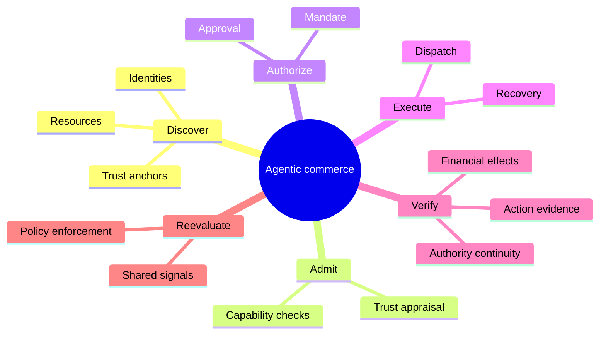

## 2. Actors and use case

A consumer delegates a shopping agent to buy size 10 running shoes for under £120, delivered by Friday, without sharing card credentials, passwords or merchant accounts. The agent discovers unfamiliar merchants; both legitimate and look-alike shops can publish profiles and signing keys. The buyer must distinguish domain control from legal identity and verify the checkout agent and actual payee role before payment.

Shipping raises the basket from £118 to £126 (revision R1). A late approval must cover the actual material terms. If the merchant issues R2 with a changed total or payee while approval is pending, R1 approval cannot transfer outside the explicitly authorized range. Revocation before dispatch prevents payment initiation.

The merchant owns payment initiation through its payment orchestration service and contracted payment processor or PSP. The shopping agent submits authorized checkout instructions, not a direct card-network transaction. The consumer, shopping agent, merchant, checkout agent, processor/PSP, acquirer, payment network or alternative rail, issuer and mandate issuer operate across distinct administrative domains. An independent witness or evaluator can provide evidence; a judge/auditor can assess it afterwards. No prior relationship or universal federation is assumed. Direct consumer–merchant workload federation is not a feasible baseline for open retail commerce. SPIFFE federation and WIMSE are excluded from the cross-domain trust path; deployments may use workload identity internally without exposing it as a prerequisite for consumers.

## 3. Discovery and trust establishment

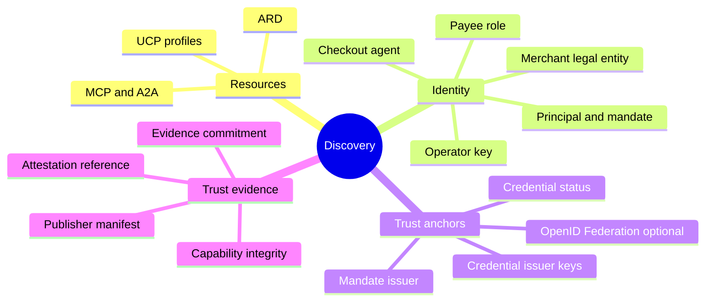

ARD describes and resolves agent resources and can bind publisher claims using a Trust Manifest [ARD-A] [ARD-D]. It does not establish legal accreditation or grant authority to spend. A publisher signature does not by itself prove consent by a different hosting origin. UCP profiles expose capabilities and keys; HTTP Message Signatures and Web Bot Auth authenticate request signing, not automatically the consumer or mandate holder [UCP] [HTTP] [WBA].

For an unfamiliar merchant, the relying party needs verifiable relationships between legal entity, domain, checkout key/workload identity, and actual payee plus role. A marketplace or facilitator may legitimately receive payment on behalf of another entity. Merchant assertions, DNS-based naming and independently issued verifiable credentials are complementary, not substitutes for this relationship [MIA] [DNSID] [VC]. Use jurisdiction-appropriate authoritative registries or independently verified legal-entity credentials through a replaceable verification adapter.

**Proposed seam:** discover issuer and publisher trust anchors with authenticated provenance, rotation and status; resolve capability descriptors; request an admission pack containing scoped identity claims, signed skills or capability digests, attestation references and evidence commitments. Validate the target origin independently. An evidence commitment is a locator/integrity binding, not evidence of good behavior by itself.

### 3.1 Credential-based trust without bilateral federation

Use independently verifiable claims and transaction-scoped authorization instead of exchanging workload trust bundles between consumers and merchants. No shared identity provider or bilateral federation is required, but each verifier must have a policy for acceptable issuers, credentials and trust anchors. Discovery alone does not make an issuer trusted.

| Component | Responsibility | Status |
|---|---|---|
| W3C VC Data Model 2.0 [VC] | Portable claims for merchant legal identity, checkout authority, agent operator and delegated roles | W3C Recommendation |
| OpenID4VCI [VCI] | Credential issuance to eligible holders | Final specification |
| OpenID4VP [VP] | Presentation and verification of requested claims, including applicable holder binding and replay protection | Final specification |
| OpenID Connect [OIDC] | Consumer authentication at an identity or person service when required | Final specification |
| OpenID Federation [FED] | Optional multilateral trust-chain and metadata discovery where a governed ecosystem exists | Final specification; not mandatory |
| AAuth [AAUTH] | Agent-to-resource authentication, person identity claims and scoped authorization | Internet-Draft -11; candidate path |
| OAuth RAR [RAR] and DPoP [DPOP] | Structured authorization details and sender-constrained OAuth tokens where the OAuth path is used | Published RFCs |
| OpenID CIBA [CIBA] | Optional decoupled consumer authentication for step-up | Final specification |
| AuthZEN [AUTHZEN] | Local policy decision interface | Authorization API |
| AP2 | Commerce mandate and payment consent binding | Protocol specification |
| SSF / CAEP / RISC | Status and risk signals between authorized participants | Final specifications |

Two complementary paths are proposed: (A) OpenID4VC-based credential presentation for portable identity and role claims, combined with OAuth/OIDC authorization where supported; (B) AAuth for signed agent requests and resource-defined authorization, optionally backed by verifiable credentials. Neither requires the merchant to federate with the consumer's workload domain. Neither a VC nor an ID token alone grants purchase authority. AP2 or an equivalent protected mandate binds material purchase terms; AAuth resource authorization is not itself an AP2 payment mandate.

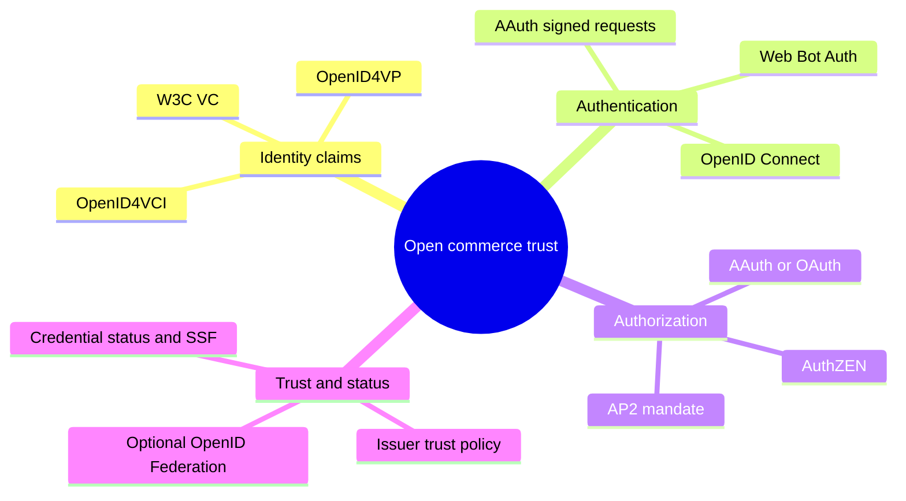

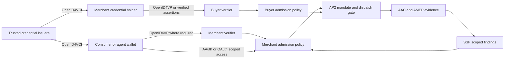

Credential verification checks accepted issuer, signature, schema, expiry, status, audience/nonce and proof of possession where the chosen format requires it. Bind the presented claims to the actual request signer, principal, resource, mandate and checkout revision through an explicit integration profile. Minimize consumer claims and use pairwise identifiers where appropriate; a merchant need not learn a consumer's civil identity for every purchase. Credential status and mandate status are separate checks. Retain authenticated verification results and protected evidence references, not unnecessary raw credentials. A DID may be used where supported but is not required by the VC model.

## 4. Admission and current authorization

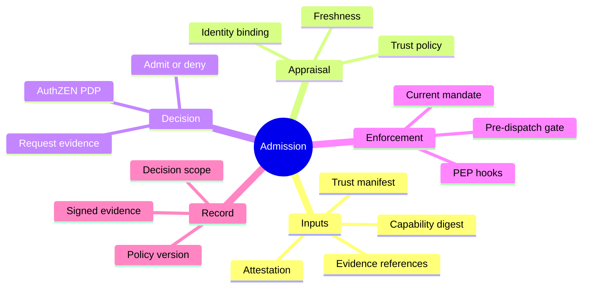

The admission service appraises the pack under local trust policy, using RATS concepts where appropriate [RATS]. AuthZEN supplies a policy evaluation interface; the PEP enforces decisions at the resource boundary [AUTHZEN] [APPROVAL]. Neither an admitted resource nor a preserved historical AMEP verdict confers transaction consent.

| Proposed hook | Check | Evidence |
|---|---|---|
| H0 Discovery appraisal | Publisher, descriptor and endpoint binding | Manifest appraisal |
| H1 Peer admission | Identity, accreditation, trust anchors | Scoped admission decision |
| H2 Capability invocation | Skill digest, attestation, allowed resource | Capability appraisal |
| H3 Mandate presentation | Issuer, principal, constraints, revision | Authorization decision |
| H4 Payment dispatch | Current authority, exact terms, replay and revocation state | Dispatch decision and call record |
| H5 Recovery | Unresolved attempts, idempotency and current approval | Recovery decision |
| H6 After execution (evaluation, not admission) | Observed effects and continuity | Reconciliation and AMEP verdict |

H0–H6 are local design labels, not ARD-defined hooks. Decisions should carry scope, policy version, validity, evidence references and authenticated issuer. A pre-dispatch gate must address the revocation/dispatch race through a sufficiently fresh decision and a defined ordering or fencing mechanism at the irreversible boundary; asynchronous signals alone cannot guarantee prevention.

## 5. Mandates, execution and recovery

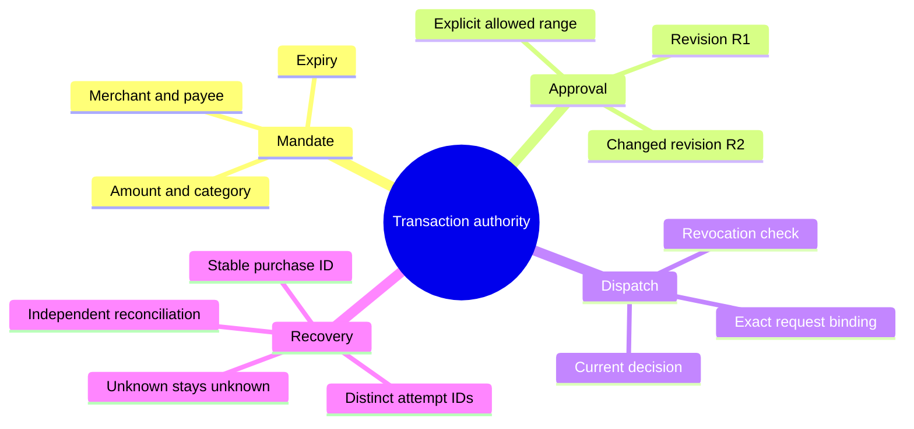

AP2 specifies checkout and payment mandate verification, including checkout binding and constraint checks, and receipt binding to a closed mandate [AP2-1] [AP2-2] [AP2-3] [AP2-4]. Preserve the exact versioned AP2 schema in adapters rather than assuming all revisions use identical field names. AAuth, Verifiable Intent and the AuthZEN approval profile remain candidate authorization building blocks [AAUTH] [VI] [APPROVAL]. Mastercard Agent Pay is an optional network-specific payment and acceptance integration, not an open mandate protocol. Its published acceptance framework describes registered agents, agentic tokens and merchant recognition using Web Bot Auth [MC] [MC-FRAMEWORK]. Mastercard Agent Pay for Machines is a separate optional integration for machine-driven payments [MC-MACHINES]. Neither is required for AP2, AAC, AMEP or SSF interoperability; the payment adapter must preserve native authorization, transaction and settlement references without asserting unsupported cross-protocol bindings.

Proposed execution binding: commit to the native mandate digest, approved revision/material terms, principal and agent, endpoint, amount, currency, payee role, request digest, purchase/operation/attempt IDs and decision reference. A pre-dispatch authorization artifact may be separate from an AAC action record; the latter records what was observed, including denial or refusal. Do not pre-assert an effect before it occurs.

AP2 autonomous-mode sequencing and receipt binding do not distinguish multiple presentations of the same closed mandate or resolve a different attempt. An error receipt is not proof of refusal before dispatch. Idempotent transport retransmission is distinct from a new financial attempt. Use durable state even when execution services are stateless. Fresh authorization does not resolve unknown effects; verified reconciliation or reliable deduplication may permit safe continuation. Unrelated purchases remain independently eligible.

## 6. Evidence layer and AMEP

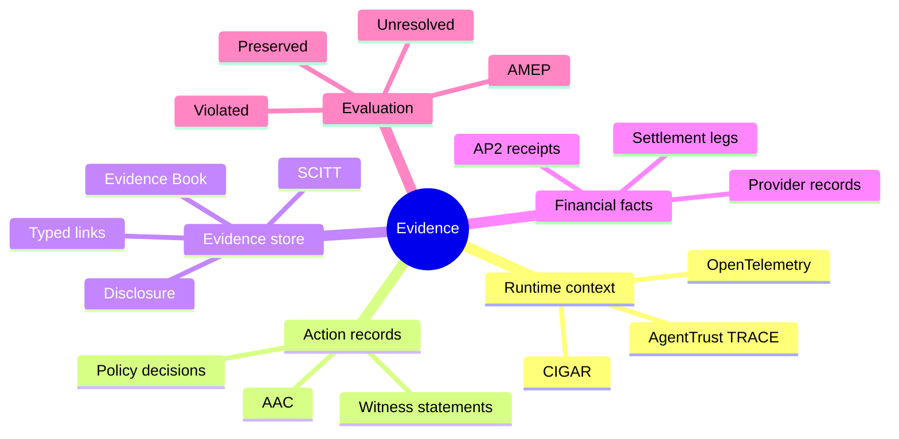

**CIGAR — Context Intelligence Graph Agentic Runtime** (HOL's published expansion) supplies governed context selection, source provenance and bounded handoffs; use its context references and integrity commitments as candidate evidence, not as proof that a model reasoned in a particular way [CIGAR]. AgentTrust (TRACE) provides signed runtime trust records [TRACE]. OpenTelemetry provides correlation and observability, not inherently independent proof [OTEL]. Avoid recording private chain-of-thought, secrets or full sensitive context; use authorized source references, digests and observable decision inputs instead.

AAC provides digest-bound action records and producer signatures, including evidence of unsuccessful or blocked actions. SCITT transparency receipts establish registration, not truth of a claim [AAC] [SCITT]. The Evidence Layer and related request/disclosure drafts provide a substrate for linking and sharing records [EL] [EL-LIB]. Native records retain their own verification and signer semantics. An AAC signature cannot elevate an unverified source claim into an independently observed fact.

AMEP (Agentic Mandate Evidence Protocol), and its derived draft *Continuity Evaluation of Agent Delegation Records*, evaluate whether delegated authority was maintained across invocation and effect evidence [AMEP]. Keep AMEP first-class: use operation correlation, signed call statements, role-specific evidence and portable verdicts. An adapter verifies each native format before mapping claims into AMEP. Evaluation results are preserved, violated or unresolved; insufficient evidence is not success. Financial outcomes remain separately sourced.

Two-party settlement records carry payer/payee observations as separate AACs [SETTLEMENT]. For card/payment-provider commerce, obtain the independent provider record as well; bilateral records do not automatically replace that evidence. Mesh-LLM capsule work is a useful implementation example for cross-node evidence and micropayment experiments [EL-LIB] [AAC-SITE].

### Proposed commerce evaluation mapping

| Concern | Evidence required |
|---|---|
| Delegation and scope | Principal, mandate, delegation chain, amount, items, merchant, payee role |
| Approval binding | Exact material terms and revision or explicitly authorized range |
| Current authority | Revocation status, policy decision, dispatch ordering |
| Context integrity | CIGAR provenance, TRACE records, signed capability and policy versions |
| Enforcement consistency | Call statement, PEP decision, independent effect observation |
| Evidence sufficiency | Verified signatures, signer roles, completeness and freshness |
| Recovery continuity | Stable operation/purchase binding, distinct attempts, carried unresolved state |

This table groups concerns rather than assigning normative AMEP invariant numbers; use the pinned draft's exact invariant definitions for conformance.

## 7. SSF and evidence-informed policy

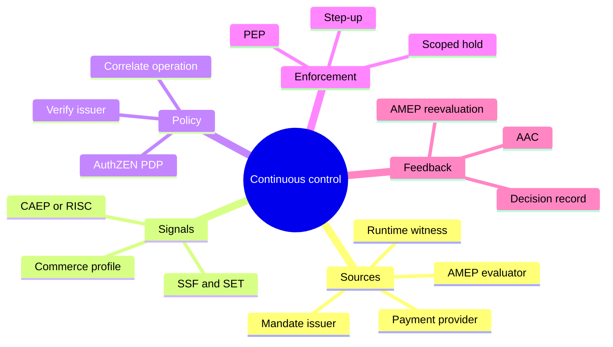

SSF distributes security events across domains; CAEP and RISC provide event semantics for their respective scopes [SSF] [CAEP] [RISC] [SET]. Reuse existing event types where semantics match. The proposed AMEP–SSF profile carries verified findings, not raw telemetry or automatic revocation commands. Receivers validate issuer, audience, signature, event authorization, replay state, scope and evidence reference before reevaluation.

| Illustrative event (not standardized) | Authorized source | Possible local response |
|---|---|---|
| mandate-revoked | Mandate issuer | Deny affected authority |
| authority-continuity-violated | AMEP evaluator | Suspend affected operation |
| authority-continuity-unresolved | AMEP evaluator | Request evidence or hold dependent action |
| authority-continuity-preserved | AMEP evaluator | Reevaluate restriction; not automatic permit |
| admission-invalidated | Admission service | Reappraise resource |
| capability-integrity-changed | Integrity/attestation service | Require readmission |
| approval-scope-mismatch | Policy evaluator | Deny or step-up |
| payment-outcome-unknown | Trusted payment observer | Hold duplicate-risk attempt |
| payment-outcome-resolved | Verified payment source | Reevaluate recovery hold |
| payment-reconciliation-mismatch | Reconciliation service | Investigate or contain |
| enforcement-bypass-detected | Authorized evaluator | Contain and investigate |

A commerce event profile needs stable event URIs, subject identifiers, purchase/operation/attempt scope, verdict digest and retrieval semantics, evaluation profile version, freshness, deduplication, supersession and privacy rules. Use pairwise identifiers where possible. An event for one attempt must not clear another attempt's unresolved status.

## 8. Cross-domain composition and component interactions

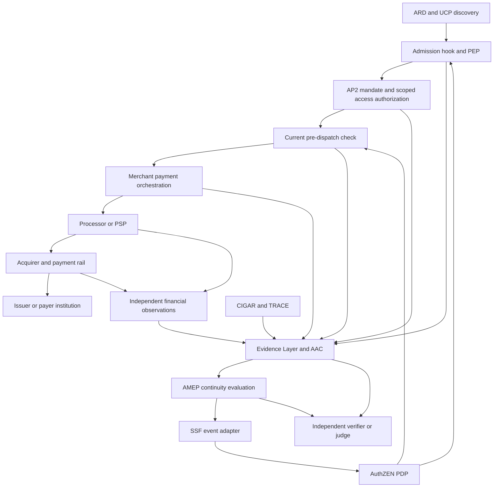

The feedback path informs future decisions; it cannot undo a completed financial effect. After dispatch use reconciliation and, where appropriate, authorized compensation or dispute processes. Evidence is captured throughout, not only after payment.

**Interaction navigation:** [Layered architecture](#81-layered-component-architecture) · [Component interactions by plane](#82-component-interactions-by-plane) · [Discovery-to-dispatch](#83-discovery-to-dispatch-interaction) · [Evidence feedback](#84-evidence-and-ssf-feedback-interaction) · [Interface contracts](#85-interaction-contracts-and-portability) · [Payment rails](#86-payment-rail-components-and-interactions) · [Financial lifecycle](#87-financial-lifecycle-and-evidence-feedback).

### 8.1 Layered component architecture

The following map locates components by responsibility rather than by vendor. The arrows in the subsequent diagrams describe interactions; the mind map itself is a taxonomy. Components may be deployed in separate trust domains. Named integrations are candidates, not mandatory dependencies.

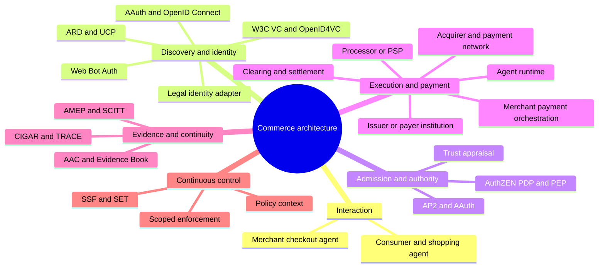

| Layer | Components | Consumes | Produces / interacts with |
|---|---|---|---|
| L1 Interaction | Consumer, shopping agent, merchant checkout agent, approval UI | Intent, catalog, material terms | Purchase identity, approval request, checkout revision |
| L2 Discovery and identity | ARD, UCP, Web Bot Auth, W3C VC, OpenID4VCI/VP, AAuth, OIDC, optional OpenID Federation, legal identity adapter | Resource query, profiles, signatures, trust anchors | Resource descriptor, verified claims, evidence references to L3 |
| L3 Admission and authorization | Trust appraisal, RATS verifier, admission hooks, AP2/AAuth, AuthZEN PDP, PEP | L2 claims, mandates, status, policy and evidence findings | Scoped decision and authorization binding to L4; decision evidence to L5 |
| L4 Runtime and payment | Agent harness, MCP/A2A where applicable, CIGAR, durable operation store, merchant payment orchestration, payment adapter, processor/PSP, acquirer, network/rail, issuer, clearing and settlement | Current decision, exact request, approved terms | Dispatch or refusal; native receipts, provider references and effect observations to L5 |
| L5 Evidence and evaluation | AgentTrust/TRACE, OpenTelemetry, AAC, Evidence Book, independent witnesses, AMEP, SCITT | Native claims, context provenance, calls, decisions and financial facts | Verified evidence graph, continuity verdict, transparency receipts to L6 and independent verifier |
| L6 Continuous trust and control | SSF transmitter/receiver, SET validation, policy information point, AuthZEN PDP/PEP | Status changes, verified findings and operation scope | Updated policy context, readmission, step-up, scoped hold or denial at L3/L4 |
| L7 Assurance and dispute | Independent verifier, judge/auditor, reconciliation service | Evidence package, native financial records, historical validation material | Independent assessment, reconciliation, authorized remediation |

### 8.2 Component interactions by plane

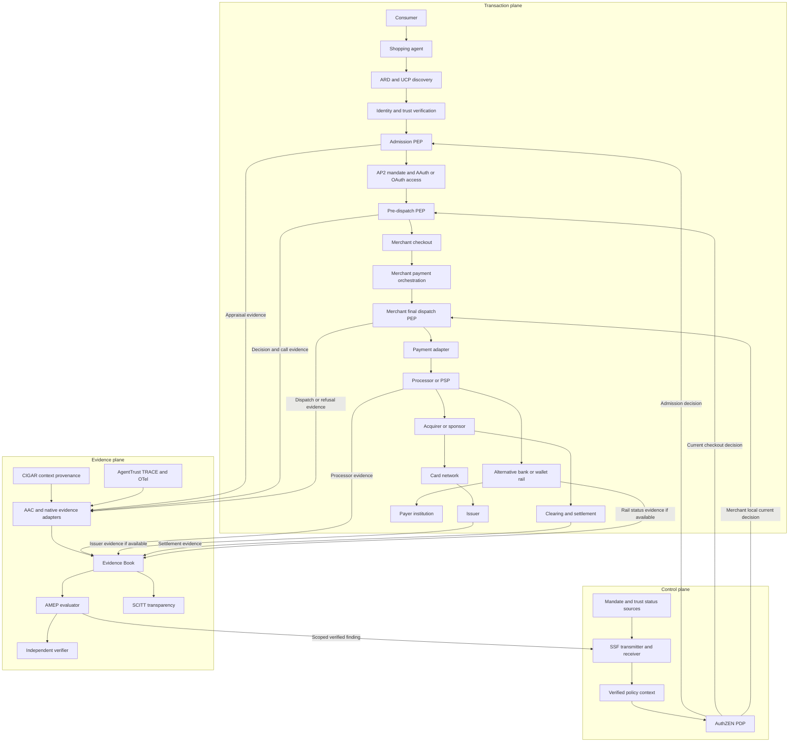

The merchant payment adapter invokes its contracted processor or PSP, which routes through the applicable acquirer/network or alternative rail. Roles may be combined in one provider. The shopping agent does not directly invoke the payment rails in this use case. Mastercard Agent Pay and Agent Pay for Machines belong behind that boundary as optional integrations. The identity adapter similarly isolates jurisdictional registries and commercial verification services. Neither external service belongs in the open protocol core.

### 8.3 Discovery-to-dispatch interaction

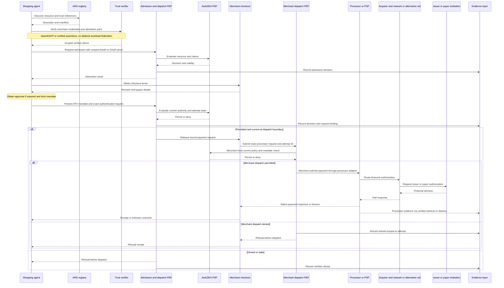

Provider-to-evidence delivery represents an authenticated integration or independent retrieval, not an assertion that every provider exposes a direct evidence API. The PEP must be located at or enforceably coupled to the actual dispatch boundary.

### 8.4 Evidence and SSF feedback interaction

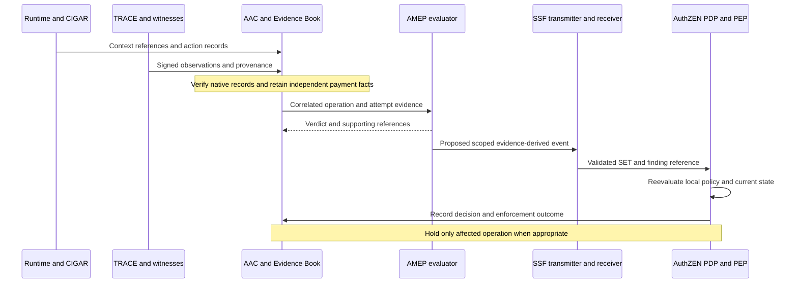

### 8.5 Interaction contracts and portability

| Interface | Minimum binding / contract | Failure behavior |
|---|---|---|
| Discovery to admission | Resource ID, endpoint, manifest digest, issuer, freshness | Unverified required claims block admission |
| Admission to authorization | Subject, resource, scope, policy version, decision expiry | Reappraise stale or changed claims |
| Authorization to dispatch | Mandate digest, revision, payee role, request digest, purchase and attempt IDs | Deny mismatch or revoked authority |
| Runtime to evidence | Context and trace references, action ID, producer, observation phase | Record missing evidence without inventing effects |
| Merchant to processor | Exact authorized amount, currency, payee role, attempt ID, idempotency reference, current merchant decision | Deny before submission or preserve unknown after submission |
| Processor to rail | Native routing and transaction references, rail-specific authorization and settlement semantics | Reconcile uncertain effects; do not infer settlement from approval |
| Payment to evidence | Provider reference, amount, currency, payee, status and provenance | Preserve unknown state; reconcile independently |
| Evidence to AMEP | Verified native artifacts, signer roles, operation/attempt correlation, evaluation version | Unresolved where evidence is insufficient |
| AMEP to SSF | Authorized event issuer, verdict reference, scope, time and supersession | Reject invalid/replayed events; no automatic permit |
| SSF to PDP/PEP | Validated event, current state, local policy and affected subject | Scoped hold or reevaluation; preserve unrelated work |

**Open-core boundary:** interfaces and portable evidence semantics are the proposed interoperability target. External identity sources and payment-network products are replaceable integrations. A provider-specific token, registration or credential does not become a universal trust anchor. No claimed native integration between Mastercard Agent Pay and AAC/AMEP/SSF is implied by these diagrams.

### 8.6 Payment rail components and interactions

The following dedicated view distinguishes commerce consent from financial authorization. AP2 and AAuth establish commerce authority and resource access; they do not replace processor, acquirer, network or issuer decisions. The merchant initiates the payment after its own enforceable pre-dispatch checks. The card route is illustrative; bank payments and wallet routes have different authorization and settlement semantics.

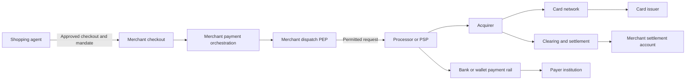

| Component | Responsibility and interaction | Evidence |
|---|---|---|
| Shopping agent | Presents authenticated checkout request and approved mandate to merchant | Request, mandate and revision binding |
| Merchant checkout | Validates terms, merchant/payee role and consumer authority | Checkout receipt and decision |
| Merchant payment orchestration | Selects approved processor, builds request, manages durable attempt state and idempotency | Request digest, purchase/attempt mapping |
| Merchant dispatch PEP | Checks current authority at actual processor submission boundary | Permit/refusal and dispatch observation |
| Processor / PSP | Accepts merchant payment request, routes it, returns native statuses and supports reconciliation | Processor payment ID, authorization/capture/refund records |
| Acquirer | Provides merchant acquiring and network access, handles clearing and merchant settlement as applicable | Acquirer transaction and settlement references |
| Card network | Routes authorization and clearing between acquiring and issuing sides | Network reference where accessible |
| Issuer | Makes financial authorization decision and maintains cardholder financial records | Issuer authorization or account evidence where accessible |
| Alternative rail / payer institution | Processes bank or wallet payment according to its own rules | Rail-specific payment and settlement references |
| Settlement / reconciliation | Matches actual financial effects to merchant order and authorized terms | Settlement, fees, adjustments and reconciliation evidence |

Mastercard Agent Pay [MC] [MC-FRAMEWORK] is an optional network-specific acceptance/token capability used with supported merchant and processor integrations; it is not itself a generic payment rail or a replacement for the merchant processor. Agent Pay for Machines [MC-MACHINES] is a separate optional machine-payment integration. The architecture remains rail-neutral.

### 8.7 Financial lifecycle and evidence feedback

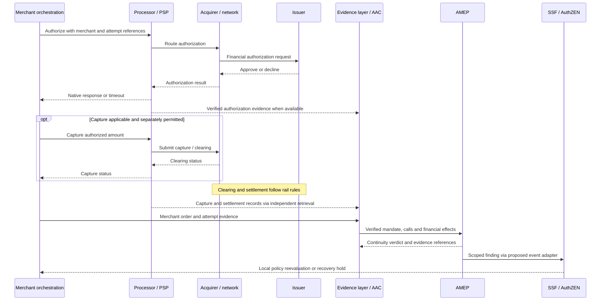

Authorization, capture, clearing and settlement are distinct; authorization success is not proof of a settled charge. Some rails combine stages. Capture, reversal and refund are separately governed actions; the merchant must not assume an unknown outcome is a failed payment. The diagram's evidence delivery arrows denote authenticated retrieval or delivery where supported, not mandatory native AAC/AMEP APIs at financial institutions. Settlement evidence should distinguish gross charge, net merchant settlement, fees, currency and adjustments; these figures are not directly interchangeable.

| Correlation boundary | Required association |
|---|---|
| Purchase to attempt | Stable purchase ID and unique attempt ID |
| Attempt to processor | Merchant request/idempotency reference and native processor payment ID |
| Processor to rail | Native acquirer/network or bank reference when available |
| Financial lifecycle | Authorization, capture, settlement, reversal/refund references and amounts |
| Financial facts to evidence | Source, signer or authenticated retrieval provenance, observed status, timestamp, AAC/evidence references |
| Evidence to AMEP / SSF | Verified effect, continuity verdict, unresolved state and scoped event reference |

## 9. Recovery and dispute handling

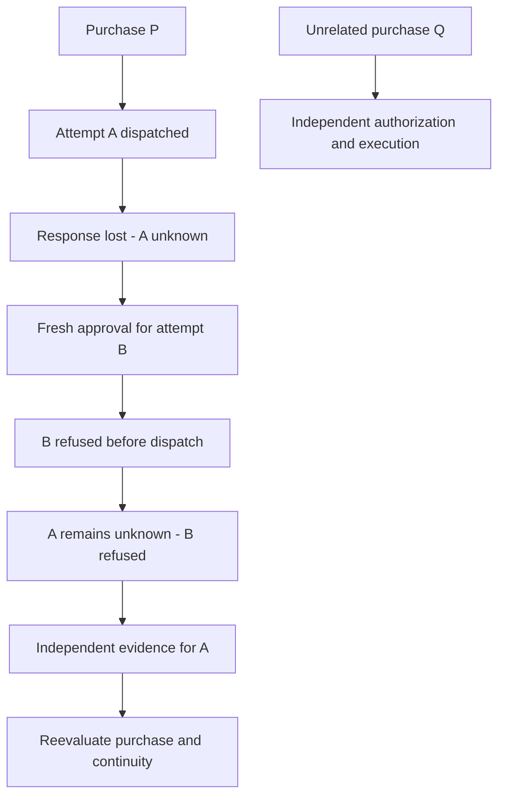

The judge or auditor verifies native evidence, authority, identity, policy and independently observed effects. Legal liability depends on applicable agreements and law, not on the mere presence of a signed record.

| Dimension | Illustrative states |
|---|---|
| Authority compliance | Within mandate; outside mandate; not established |
| Attempt execution | Not dispatched; refused before dispatch; dispatched; confirmed success/failure; unknown |
| Financial outcome | Not charged; pending; captured; settled; reversed/refunded; unknown |
| AMEP continuity | Preserved; violated; unresolved |

These are independent dimensions. A payment may be within scope but financially unresolved; a verified charge alone does not establish compliance with every authority invariant. A merchant-only amount does not establish the independently observed charge.

## 10. Acceptance cases

### Retained from Revision 3 (paraphrased)

| ID | Implementation-neutral acceptance condition |
|---|---|
| 1 | Original £120 limit does not authorize £126. |
| 2 | Valid new approval permits payment only within scope and when required parties permit it. |
| 3 | Delayed approval does not cover changed terms outside scope; revocation before dispatch prevents initiation. |
| 4 | Fresh approval does not resolve an earlier dispatched attempt with unknown outcome or remove its purchase relationship. |
| 5 | Independently authorized unrelated purchase completes while the first remains unresolved. |
| 6 | A is dispatched with unknown outcome; B is verifiably refused before dispatch. Preserve both states. B's error receipt alone is insufficient to prove refusal, and B's refusal does not settle A. |
| 7 | Merchant-only charge figure yields not established. |

### Proposed additions for Revision 4

| ID | Acceptance condition | Candidate integration |
|---|---|---|
| 8 | Missing required merchant/checkout identity evidence prevents admission under the test policy. | ARD + admission |
| 9 | Valid identity cannot compensate for a failed required capability integrity check. | Manifest + attestation |
| 10 | Revoked trust anchor triggers scoped reevaluation of dependent admissions. | SSF + PDP |
| 11 | Substituted endpoint, payee or material terms outside approval are blocked before dispatch. | AP2 + PEP + binding |
| 12 | Independent effect contradicting a verified denial is detected. | AAC + AMEP |
| 13 | Merchant self-report alone does not establish independently required financial facts. | AMEP + provider evidence |
| 14 | Verified continuity finding triggers scoped policy reevaluation, without blanket revocation. | AMEP + SSF + AuthZEN |
| 15 | Historical evidence remains verifiable across key rotation, subject to retained validation material. | AAC + Evidence Layer + SCITT |
| 16 | Independent implementations evaluate identical evidence under identical pinned rules consistently. | AMEP conformance |
| 17 | Replayed or superseded event does not improperly reopen a resolved attempt. | SSF + durable state |
| 18 | Sufficient verified context provenance permits detection of an unauthorized effect associated with altered context. | CIGAR + TRACE + AAC + AMEP |
| 19 | Previously unrelated consumer and merchant complete a permitted purchase using accepted credential or AAuth/OAuth proofs without bilateral workload federation. | OpenID4VC + AAuth/OAuth + AP2 |
| 20 | A valid credential presented by an unauthorized request signer, or a credential from an untrusted issuer, does not satisfy admission. | VC verification + request binding |
| 21 | Credential status change triggers scoped reevaluation, without treating credential validity as mandate validity. | Status + SSF + AuthZEN |
| 22 | The merchant, not the shopping agent, initiates the financial request through its approved processor; a denied merchant dispatch produces no processor submission. | Merchant PEP + processor adapter |
| 23 | An approved financial authorization is not treated as capture or settlement; independent processor/rail evidence resolves each applicable stage. | Processor + AAC + AMEP |
| 24 | A lost processor response retains the attempt as unknown; reconciliation uses native payment references and prevents duplicate financial effects. | Durable state + processor reconciliation + AMEP + SSF |

## 11. Standards gaps (Revision 3 taxonomy retained)

| Category | Proposed additions | Acceptance cases |
|---|---|---|
| Identity | Credential-based principal/operator/mandate binding; legal entity/domain/checkout/payee linkage | 8, 9, 11, 19, 20 |
| Delegated Authority and Authorization | Scope/revision binding; current approval; operation/attempt correlation; continuity evaluation | 1–6, 11, 12 |
| Cross-Domain Federation & Data Sharing | Issuer trust discovery without bilateral workload federation; authenticated evidence exchange; independent provider observations; SSF | 7, 10, 13–15, 19, 21 |
| Ecosystem Interoperability | ARD admission references; native evidence adapters; shared refusal/outcome semantics | 8, 9, 16, 18 |
| Life Cycle Management | Revocation, recovery, durable unresolved state, historical verification, event supersession | 3–6, 10, 14, 15, 17 |

## 12. Proposed work items and implementation status

| Work item | Priority | Deliverable |
|---|---|---|
| P1 ARD evidence and admission | First | Admission pack semantics, trust references, hook contract and refusal vocabulary |
| P2 AP2–AAC–AMEP commerce evidence | First | Native artifact bindings, operation/attempt model, independent financial evidence |
| P3 TRACE–CIGAR–AAC context binding | Next | Context provenance and runtime record references, disclosure rules |
| P4 AMEP–SSF continuous authorization | Next | Event schema, scoped policy inputs, ordering and supersession |
| P5 Interoperability test suite | Throughout | Positive/negative vectors and independent implementations |

Publicly documented: ARD drafts, AAC and Evidence Layer drafts, settlement records, AMEP continuity draft, HOL CIGAR, TRACE, Mesh-LLM capsule work and a proposed ARD evidence commitment. Reported by the proposer: micropayment use of AAC in Mesh-LLM, package integration with CIGAR and AgentTrust/TRACE, and ARD testing in collaboration with Google. The complete combined integration and collaboration status have not been independently established here; track them as work in progress with links to commits, test vectors and reproducible results when available. Do not present them as adopted standards or endorsed implementations.

## 13. References

Pinned draft links are used where independently checked; other pointers are live references or inherited from Revision 3. Internet-Drafts and draft profiles are work in progress. Access date: 27 November 2026.

| Key | Source | Status / purpose |
|---|---|---|
| MAP | [Agentic Standards Map][MAP] | Research map; presentation inspiration |
| ARD-A | [ARD Architecture -00][ARD-A] | Internet-Draft |
| ARD-D | [ARD Manifest and Lookup -00][ARD-D] | Internet-Draft |
| AAC | [Agent Action Capsule -06][AAC] | Internet-Draft |
| EL | [Evidence Layer -01][EL] | Internet-Draft |
| SETTLEMENT | [Two-Party Settlement Records -01][SETTLEMENT] | Internet-Draft |
| AMEP | [Continuity Evaluation -02][AMEP] | Internet-Draft derived from AMEP |
| CIGAR | [HOL CIGAR][CIGAR] | Open-source implementation |
| TRACE | [AgentTrust TRACE][TRACE] | Open specification |
| EL-LIB | [Evidence Layer Library][EL-LIB] | Implementation and proposal status |
| AAC-SITE | [AAC project][AAC-SITE] | Implementation documentation |
| AP2 | [AP2 verification][AP2-1], [autonomous mode][AP2-2], [checkout receipt][AP2-3], [payment mandate][AP2-4], [payment receipt][AP2-5] | Protocol documentation |
| AUTHZEN | [AuthZEN][AUTHZEN], [approval profile][APPROVAL] | API and draft profile |
| SSF | [SSF] [SSF], [CAEP] [CAEP], [RISC] [RISC], [SET RFC 8417][SET] | Security event exchange |
| Identity | [Web Bot Auth][WBA], [HTTP signatures][HTTP], [UCP] [UCP], [W3C VC][VC], [OpenID4VCI][VCI], [OpenID4VP][VP], [OIDC][OIDC], [merchant assertions][MIA], [DNSID] [DNSID] | Mixed specifications and drafts |
| Delegation | [AAuth -11][AAUTH], [OAuth RAR][RAR], [DPoP][DPOP], [CIBA][CIBA], [Verifiable Intent][VI] | Candidate authorization building blocks |
| Payment network integration | [Mastercard Agent Pay][MC], [Acceptance Framework][MC-FRAMEWORK], [Agent Pay for Machines][MC-MACHINES] | Optional provider-specific products and integration guidance; not open standards |
| Assurance | [RATS] [RATS], [SCITT] [SCITT], [OpenTelemetry][OTEL] | Attestation, transparency, observability |
| Related | [Evidence Request][ER], [Evidence Bundle][EB], [AAC OTel profile][AAC-OTEL], [OpenID Federation][FED], [Web Bot Auth refusal outcomes][REFUSAL] | Related pointers; verify current revisions before implementation |

[VC]: https://www.w3.org/TR/vc-data-model-2.0/
[VCI]: https://openid.net/specs/openid-4-verifiable-credential-issuance-1_0-final.html
[VP]: https://openid.net/specs/openid-4-verifiable-presentations-1_0-final.html
[OIDC]: https://openid.net/specs/openid-connect-core-1_0.html
[CIBA]: https://openid.net/specs/openid-client-initiated-backchannel-authentication-core-1_0.html
[RAR]: https://www.rfc-editor.org/rfc/rfc9396.html
[DPOP]: https://www.rfc-editor.org/rfc/rfc9449.html
[MAP]: https://frmoretto.github.io/agentic-standards-map/
[ARD-A]: https://datatracker.ietf.org/doc/html/draft-bu-dawn-ard-architecture-00
[ARD-D]: https://datatracker.ietf.org/doc/html/draft-bu-dawn-ard-discovery-00
[AAC]: https://datatracker.ietf.org/doc/html/draft-mih-scitt-agent-action-capsule-06
[EL]: https://datatracker.ietf.org/doc/html/draft-mih-agent-evidence-layer-01
[SETTLEMENT]: https://datatracker.ietf.org/doc/html/draft-mih-agent-settlement-records-01
[AMEP]: https://datatracker.ietf.org/doc/html/draft-stafordtituss-agentic-mandate-evidence-02
[CIGAR]: https://github.com/hashgraph-online/hol-cigar
[TRACE]: https://github.com/agentrust-io/trace-spec
[EL-LIB]: https://actionstate.ai/Evidence_Layer_Library
[AAC-SITE]: https://agentactioncapsule.org/
[AP2-1]: https://ap2-protocol.org/ap2/specification/#merchant
[AP2-2]: https://ap2-protocol.org/ap2/specification/#autonomous-human-not-present
[AP2-3]: https://ap2-protocol.org/ap2/checkout_mandate/#checkout-receipt
[AP2-4]: https://ap2-protocol.org/ap2/payment_mandate/#mandate-schema
[AP2-5]: https://ap2-protocol.org/ap2/payment_mandate/#payment-receipt
[AUTHZEN]: https://github.com/openid/authzen
[APPROVAL]: https://openid.github.io/authzen/authzen-access-request-approval-profile-1_0.html
[SSF]: https://openid.net/specs/openid-sharedsignals-framework-1_0-final.html
[CAEP]: https://openid.net/specs/openid-caep-1_0-final.html
[RISC]: https://openid.net/specs/openid-risc-profile-1_0-final.html
[SET]: https://www.rfc-editor.org/rfc/rfc8417.html
[HTTP]: https://www.rfc-editor.org/rfc/rfc9421.html
[WBA]: https://datatracker.ietf.org/doc/draft-ietf-webbotauth-httpsig-protocol/
[UCP]: https://ucp.dev/
[MIA]: https://datatracker.ietf.org/doc/draft-anders-merchant-identity-assertions/
[DNSID]: https://datatracker.ietf.org/doc/draft-ihsanullah-dnsid/
[AAUTH]: https://datatracker.ietf.org/doc/html/draft-hardt-oauth-aauth-protocol-11
[VI]: https://verifiableintent.org/
[MC]: https://www.mastercard.com/global/en/business/artificial-intelligence/mastercard-agent-pay.html
[MC-FRAMEWORK]: https://www.mastercard.com/us/en/news-and-trends/stories/2025/agentic-commerce-framework.html
[MC-MACHINES]: https://www.mastercard.com/us/en/business/artificial-intelligence/mastercard-agent-pay/agent-pay-for-machines.html
[RATS]: https://www.rfc-editor.org/rfc/rfc9334.html
[SCITT]: https://www.rfc-editor.org/rfc/rfc9943.html
[OTEL]: https://opentelemetry.io/
[ER]: https://datatracker.ietf.org/doc/draft-mih-agent-evidence-request/
[EB]: https://datatracker.ietf.org/doc/draft-mih-zhang-agent-disclosure-bundle/
[AAC-OTEL]: https://datatracker.ietf.org/doc/draft-palanisamy-scitt-aac-otel/
[FED]: https://openid.net/specs/openid-federation-1_1-final.html
[REFUSAL]: https://datatracker.ietf.org/doc/draft-suresh-webbotauth-verification-outcome/

---

**Design principle:** Discovery is not admission; admission is not consent; consent is not execution; execution is not settlement; evidence integrity is not evidence truth. AMEP evaluates continuity of authority from verified evidence, and SSF enables scoped reevaluation without replacing the local decision or enforcement boundary.
